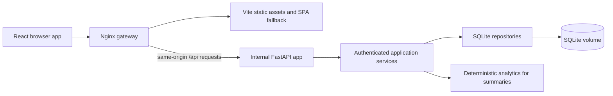
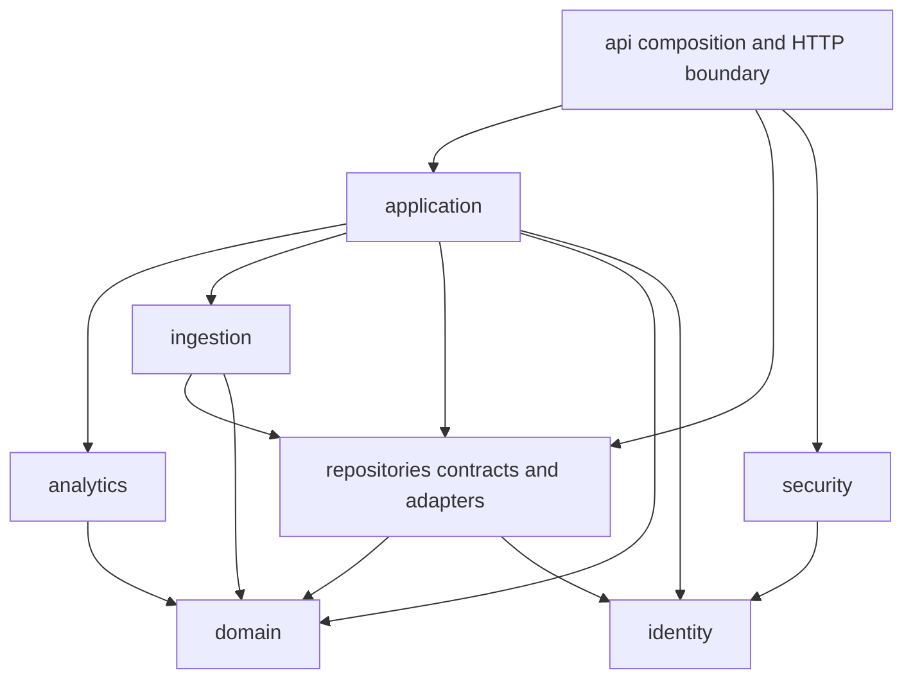

# Architecture

MVP1 combines a React/TypeScript browser application with an authenticated FastAPI API and
SQLite persistence. Deterministic analytics produce descriptive baselines, mathematical
trends, and structured summaries. There is no separate implemented insight-rule engine.
See [Product scope](product-scope.md) for capability and general-wellness boundaries.

## Runtime request flow

The production-shaped [Compose stack](../deploy/compose.yml) runs two unprivileged containers.
The Node.js 22 [web build](../deploy/web.Dockerfile) produces Vite assets served by Nginx;
the Python 3.13 [API image](../deploy/api.Dockerfile) runs FastAPI under Uvicorn.

These arrows show runtime requests and calls; responses return to the caller. Only the
gateway is published to the host, on port `8080` by default. Its
[Nginx configuration](../deploy/nginx.conf) proxies `/api/` to `api:8000` and serves
`index.html` for browser routes. The browser uses the same origin without a CORS exception.
External HTTPS termination and HSTS are operator responsibilities; the bundled gateway
serves HTTP. Development and preview use the [Vite proxy](../web/vite.config.ts).

The [application factory](../src/lifelenz/api/app.py) constructs settings and a per-app
[dependency container](../src/lifelenz/api/dependencies.py). HTTP schemas and explicit
transport mappings translate requests into domain values and results into responses.
Application services resolve ownership, coordinate repositories, and translate expected
missing-entity failures. Domain constructors enforce invariants before storage.

## Packages and source dependencies

Production Python code uses the `src/lifelenz/` package layout. These are implemented packages:

| Package | Responsibility |
| --- | --- |
| [domain](../src/lifelenz/domain/) | Immutable records, profiles, goals, controlled metrics/units, identifiers, aware time ranges, and validation. |
| [identity](../src/lifelenz/identity/) | Account identity: `UserId`, canonical email addresses, and account values, separate from wellness profiles. |
| [security](../src/lifelenz/security/) | Argon2 password hashing and fixed-algorithm HS256 access-token issuance/validation. |
| [repositories](../src/lifelenz/repositories/) | Storage-neutral protocols, in-memory profile/goal/record implementations, SQLite adapters, and explicit serialization. |
| [analytics](../src/lifelenz/analytics/) | Pure canonical sample extraction, descriptive personal baselines, and mathematical trends. |
| [ingestion](../src/lifelenz/ingestion/) | CSV v1 parsing, domain validation, unit normalization, and semantic duplicate identity. |
| [application](../src/lifelenz/application/) | Profile, record, goal, authentication, ownership, CSV, and summary use cases. |
| [api](../src/lifelenz/api/) | FastAPI routes, configuration, authentication dependencies, transport schemas/mappings, error handling, and composition. |

The following arrows mean **source dependency**, not HTTP traffic or a processing pipeline:

This is a package-level map of principal dependencies, not every import. Application services
accept [repository contracts](../src/lifelenz/repositories/contracts.py); API composition
selects SQLite adapters. Authentication orchestration accepts a password-hasher protocol
instead of importing the concrete security adapter. Domain and identity values do not depend
on application services, storage, or FastAPI. Analytics performs no repository I/O. CSV parsing
uses the shared record contract but does not persist records itself.

## Identity, authorization, and browser state

[Registration](../src/lifelenz/application/authentication.py) creates an account only.
Separate [profile onboarding](../src/lifelenz/application/authenticated_profile.py) creates
one primary wellness profile and assigns an explicit `UserId -> ProfileId` ownership mapping.
Profile preferences contain no authentication credentials.

Bearer-protected dependencies verify token signature, required claims, issuer, audience, and
expiry, then load the authoritative active account. Authenticated services derive the primary
profile from ownership; wellness-resource clients cannot choose a profile identifier.
Record and goal access stays within that profile, with cross-account lookups returning the
same not-found response as absent resources. Corrections preserve record ID, concrete type,
and original provenance.

The [React Router configuration](../web/src/app/router.tsx) provides `/`, `/register`, `/login`,
and protected `/app`, `/app/records`, `/app/records/import`, `/app/goals`, and `/app/profile`.
Profile guards direct accounts without a profile to onboarding. The
[authentication provider](../web/src/auth/AuthProvider.tsx) restores identity through
`/api/v1/auth/me`, stores only the short-lived bearer token in `sessionStorage`, and clears
client state and the query cache on logout or rejected authentication. Browser storage remains
exposed to script access; logout does not revoke issued tokens. Refresh tokens, password reset,
email verification, and MFA are outside the implemented lifecycle.

## Domain and durable storage contracts

Domain construction validates controlled types, finite numeric values and allowed ranges,
canonical-unit compatibility, and record-specific relationships. For example, completed sleep
and workout periods must have positive duration. [TimeRange](../src/lifelenz/domain/primitives.py)
uses aware timestamps and start-inclusive/end-exclusive bounds; record filtering and analytics
use `metadata.recorded_at`, rather than inferring local calendar periods from preferences.

[SQLite repositories](../src/lifelenz/repositories/sqlite.py) persist profiles, goals, all ten
record types, accounts, and ownership mappings. Profiles, goals, and records use
[explicit versioned JSON serialization](../src/lifelenz/repositories/serialization.py), with
typed reconstruction and domain validation. Accounts and ownership use explicit SQL columns.
Canonical units and original aware timestamp offsets survive reconstruction; UTC epoch values
support chronological record filtering and ordering, with record ID as the ordering tie-breaker.

Repository initialization manages `schema_metadata` and the supported migration from schema
version 1 to 2, adding account/ownership storage. Unsupported schema versions fail rather than
being silently accepted. Application services enforce profile existence and ownership because
the storage contracts do not substitute for authorization or provide cascading account deletion.

Run **one API instance per SQLite database volume**. The active database is not encrypted by
this implementation. SQLite transactions and persistence across restarts do not establish
horizontal scaling, high availability, shared-network storage safety, or managed failover.

## CSV validate, review, and atomic commit

The [browser workflow](../web/src/imports/CsvImportWorkflow.tsx) selects a local file, requests
server validation, shows issues and duplicates, and requires an explicit commit. Both modes
use authenticated `POST /api/v1/imports/csv`; commit parses and validates the submitted file again.
CSV v1 supports six categories with canonical-unit normalization and `csv_import` provenance.
See [CSV schema v1](csv-import-v1.md) for exact headers, limits, and duplicate semantics.

The [import service](../src/lifelenz/application/authenticated_imports.py) resolves existing owned
records through the authenticated record service, skips semantic duplicates, and writes nothing
in validate mode or when any validation issue exists. Ready rows pass through
`AuthenticatedWellnessRecordService.create_records`, `WellnessRecordService.save_records`,
and the repository's `save_batch` contract. SQLite serializes the entire batch before writing
through one connection and transaction. Storage failure rolls back every batch change, preserves
pre-existing records, and becomes HTTP 503 without reporting an imported count. A retry skips
records from an earlier successful import.

## Server-derived summaries and dashboard

[WellnessSummaryService](../src/lifelenz/application/summaries.py) loads owned records and groups
canonical samples by metric. A baseline needs at least one sample and includes count, mean,
median, minimum, maximum, and population standard deviation. With at least two samples,
[trends](../src/lifelenz/analytics/trends.py) add first/last values, absolute change, percentage
change when the first value is nonzero, least-squares slope per day, and neutral direction.
Increasing/decreasing/stable describes mathematics without assigning health meaning.

[Sample extraction](../src/lifelenz/analytics/baselines.py) deliberately excludes meal events
in favor of daily nutrition totals; menstrual records have no numeric mapping. Not every stored
field becomes a metric. Samples use metadata timestamps without daily regrouping or overlap
deduplication between workout and daily activity records. The summary record count includes all
selected records, even those without extractable metrics. No supported samples produces
`wellness_summary_unavailable`; the browser shows an empty state.

Authenticated `GET /api/v1/summary` supports metric selection and paired aware `start`/`end`
bounds. The [dashboard](../web/src/pages/DashboardPage.tsx) requests the default summary and
renders coverage, observed baseline ranges with mean/median markers, and mathematical trend
details. The response is structured descriptive data, without a historical sample-series
contract, narrative reports, goal evaluation, correlations, predictions, or recommendations.

TanStack Query owns browser server-state caching. Successful record creation, correction,
deletion, and CSV commit invalidate record-list/history queries and the summary so subsequent
reads fetch current server calculations. Goal mutations invalidate goal queries. Profile
measurement-system, time-zone, and week-start preferences are stored; they do not implement
summary unit conversion or local-calendar grouping.

## Deployment, recovery, and release boundaries

[Deployment](deployment.md) defines startup configuration, gateway headers, and SQLite
maintenance. Production settings fail closed unless docs are disabled, the database path is
absolute, and the signing secret contains at least 48 UTF-8 bytes. The maintenance helper uses
SQLite backup and integrity checks; restore requires confirmation that API writers are stopped.

[CI](../.github/workflows/ci.yml) checks backend/web behavior, security invariants, package
integrity, and the [real-browser critical journey](browser-e2e.md). Deployment Validation checks
the production Compose contract and restart persistence. MVP1 Release Validation separately
checks metadata, builds flat checksum-verified assets, and proves backup/restore into fresh
storage after destroying a disposable volume. The tag-only publishing job in
[release.yml](../.github/workflows/release.yml) verifies and publishes those validated assets.
See [Release](release.md) for the exact-source and tag contract.

These checks do not establish public-production readiness. External HTTPS/HSTS, off-host backup
retention/encryption/access policy, host and secret access, monitoring, alerting, incident response,
and abuse controls remain operator responsibilities under [Release readiness](release-readiness.md).
PostgreSQL, wearable integrations, ML inference, LLM explanations, and richer evidence-facing
insight rules remain future work; they are not additional runtime layers in MVP1.
